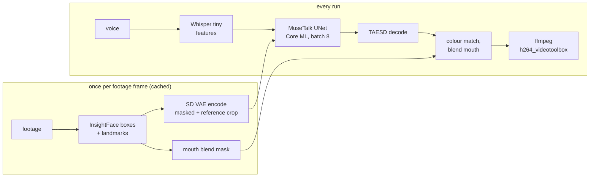

# fast-lipsync

Lip-sync a talking-head video to any voice track on an Apple Silicon Mac, at close to real time.

```sh
./lipsync.sh footage.mp4 voice.wav out.mp4
```

fast-lipsync runs [MuseTalk 1.5](https://github.com/TMElyralab/MuseTalk) with the UNet compiled to Core ML,
a tiny latent decoder, and a per-frame cache of everything that depends only on the footage. On an M4 Pro,
generating new mouths for 1080×1920 video runs at about 21 frames per second once the footage is cached.
The output is 25 fps, so a 24-second clip takes about 35 seconds end to end, model loading included.

It has two mouth modes:

| mode | where the mouth pixels come from | best for |
|---|---|---|
| `generated` (default) | MuseTalk's 256 px output, colour-matched and sharpened into the frame | any footage, no preparation |
| `real` | the speaker's own recorded mouths, chosen to match MuseTalk's mouth shape | sharp teeth and true skin tone, given a few minutes of extra footage of the same person |

## Requirements

- Apple Silicon Mac on macOS 15 or later (the Core ML model targets macOS 15)
- [uv](https://docs.astral.sh/uv/), `ffmpeg`, `git`
- About 6 GB of disk for weights and the Core ML package

## Install

```sh
git clone https://github.com/Lulzx/fast-lipsync && cd fast-lipsync
./setup.sh
```

`setup.sh` creates a Python 3.11 environment in `.venv`, clones MuseTalk into `vendor/` and applies a small
patch so it runs without CUDA, downloads the weights (MuseTalk 1.5 UNet, SD VAE, Whisper tiny, TAESD,
InsightFace detection and landmarks, MediaPipe hand landmarker), and compiles the UNet to Core ML. It is safe to
run again and skips anything already present.

## Usage

Lip-sync one continuous take, starting 12.5 seconds into the footage:

```sh
./lipsync.sh footage.mp4 voice.wav out.mp4 --start 12.5
```

Stitch several takes into one clip with a timeline. Each entry says which output seconds (`t0` to `t1`) show the
footage from `src_start` onwards. The entries must cover the whole voice track.

```json
[
  {"src_start": 7.0,  "t0": 0.0,  "t1": 4.03},
  {"src_start": 41.2, "t0": 4.03, "t1": 9.80}
]
```

```sh
./lipsync.sh footage.mp4 voice.wav out.mp4 --timeline cuts.json
```

The result is 25 fps H.264 from the hardware encoder at 24 Mb/s, with the voice track muxed in as AAC. Re-encode
it with `libx264` if it is the final delivery and file size matters.

### Options

| flag | default | effect |
|---|---|---|
| `--start S` | `0` | footage second to start from (single take) |
| `--timeline F` | | JSON list of cuts, overrides `--start` |
| `--mouth generated\|real` | `generated` | where mouth pixels come from (see below) |
| `--library NAME` | footage file stem | mouth library for `--mouth real` |
| `--ref open\|same` | `open` | reference image for MuseTalk: the most open mouth in each cut, or the frame itself |
| `--decoder taesd\|vae` | `taesd` | latent decoder. `vae` is the full SD VAE MuseTalk was trained with, about 17× slower |
| `--unet coreml\|mps` | `coreml` | Core ML package, or the PyTorch UNet on MPS |

### Warming the cache

The first run on a new video prepares every source frame it touches, at about 0.13 s per frame. Later runs on
the same footage reuse that work and only prepare frames they have not seen. To prepare a whole video ahead of
time:

```sh
.venv/bin/python -I tools/prepare.py footage.mp4 [--start 0] [--duration 60]
```

## How it works



Stock MuseTalk runs face detection, VAE encoding, the UNet, VAE decoding and face parsing on every frame of
every run. fast-lipsync keeps the UNet and moves or replaces the rest.

1. **Footage cache.** Face boxes, VAE latents of the masked and reference crops, blend masks and mouth openness
   do not depend on the audio. `tools/prepare.py` computes them once per source frame and stores them in
   `cache/avatar/<footage stem>/`.
2. **InsightFace for face boxes.** MuseTalk's mmpose and DWPose stack does not build on macOS. InsightFace's
   detector and 106-point landmarks run through ONNX Runtime's Core ML provider, and the boxes are averaged
   over 5 frames within each cut so the crop holds still.
3. **Core ML UNet.** `tools/convert_unet_coreml.py` traces the UNet at a fixed batch of 8 and compiles it to an
   fp16 ML program. It remains the slowest stage, at about 30 fps on its own.
4. **TAESD decoder.** The tiny autoencoder decodes the UNet's latents about 17× faster than the SD VAE on MPS,
   with no rescaling needed.
5. **Mouth-only blend.** A feathered oval around the lips, stored at 256 px, replaces MuseTalk's face-parsing
   jaw mask. It costs less and leaves the moustache and beard untouched. The generated mouth is matched to the
   frame's colour in Lab space, gets the frame's fine texture back, and is sharpened.
6. **Open-mouth reference.** MuseTalk copies teeth and lip detail from its reference image. Using the most
   open mouth in each cut as the reference gives visible teeth.
7. **Pipelined output.** A 6-thread pool blends frames while the UNet works on the next batch, and finished
   frames stream straight into the hardware encoder.

### Real-mouth mode

MuseTalk's mouths can look soft at 1080p, and teeth or skin tone can drift. In real-mouth mode MuseTalk only
decides the mouth shape, and every mouth pixel in the result comes from footage of the speaker.

Build a mouth library once from a few minutes or more of the same person talking. More footage gives more
shapes to choose from. Building takes about 0.7× the footage length.

```sh
.venv/bin/python -I tools/mouth_library.py raw-footage.mp4
./lipsync.sh footage.mp4 voice.wav out.mp4 --mouth real --library raw-footage
```

`tools/mouth_library.py` reads every second frame. For each, it records the 106 landmarks, the mouth patch
warped into a canonical frame anchored on the eyes and nose (which stay still while talking), and a descriptor
of the lip shape. MediaPipe flags frames with a hand near the mouth, and those are never used.

At run time, MuseTalk runs on every second output frame and the shape is interpolated in between.
`tools/real_mouth.py` looks up the 12 nearest real mouths for each frame and runs Viterbi over them. Continuing
a run of consecutive real frames costs nothing, and jumping to another moment costs `SWITCH_COST`, so the
result plays back long stretches of real motion. Each chosen patch is warped onto the face, colour-matched and
feathered, with a one-frame cross-fade at jumps.

## Speed

Measured on an M4 Pro with 1080×1920 footage and a warm cache:

| stage | cost |
|---|---|
| loading models | about 4.3 s per run |
| generated mouths (UNet, decode, blend, encode) | about 21.5 output frames per second |
| real mouths | about 25 output frames per second |
| preparing a new footage frame (first run only) | about 0.13 s |

## Fine-tuning on one speaker (experimental)

A LoRA fine-tune of the UNet on footage of one person can sharpen generated mouths. It needs the mouth library
for that footage.

```sh
.venv/bin/python -I tools/train_data.py footage.mp4                 # crops, latents and audio features
.venv/bin/python -I tools/finetune.py footage.mp4 --steps 3000      # about 1 h on an M4 Pro
.venv/bin/python -I tools/convert_unet_coreml.py 8 --weights models/musetalk_ft/<stem>/unet.pth --name <stem>
```

The loss combines latent L1, pixel L1 and VGG perceptual loss on the TAESD-decoded lower half of the face.
`lipsync.py` loads the fine-tuned Core ML package automatically for footage with that stem. This path has not
yet been run through a full training schedule, so treat its defaults as a starting point.

## Repository layout

| path | contents |
|---|---|
| `lipsync.sh` | entry point |
| `tools/lipsync.py` | audio features, UNet, decode, blend, encode |
| `tools/prepare.py` | footage cache |
| `tools/convert_unet_coreml.py` | MuseTalk UNet to Core ML |
| `tools/mouth_library.py`, `tools/real_mouth.py` | real-mouth mode |
| `tools/train_data.py`, `tools/finetune.py` | speaker fine-tune |
| `patches/musetalk-mps.patch` | runs MuseTalk's face parser off CUDA |

Generated files go to `cache/` (footage cache, mouth libraries, training sets) and `models/` (weights and Core ML
packages). Both are git-ignored.

## Limitations

- One dominant, roughly front-facing face per frame. Profile shots and hands over the mouth give poor results.
- In generated mode, MuseTalk redraws the area inside the mouth mask at 256 px, so facial hair there comes out
  smoother than the rest of the face.
- Real-mouth mode can only reproduce mouth shapes that appear somewhere in the library footage.
- macOS only. The Core ML UNet, the hardware encoder and the MPS paths are Apple-specific.

## Licenses

The code in this repository is MIT licensed (see `LICENSE`). The models it downloads have their own terms,
which apply to any use of the output. In particular, InsightFace's pretrained models are released for
non-commercial research only. Check the licenses of MuseTalk, Stable Diffusion's VAE, Whisper, TAESD and
MediaPipe before commercial use.

## Acknowledgements

Built on [MuseTalk](https://github.com/TMElyralab/MuseTalk) (Tencent Music Lyra Lab),
[TAESD](https://github.com/madebyollin/taesd), [InsightFace](https://github.com/deepinsight/insightface),
[Whisper](https://github.com/openai/whisper), [MediaPipe](https://github.com/google-ai-edge/mediapipe) and
[Core ML Tools](https://github.com/apple/coremltools).
